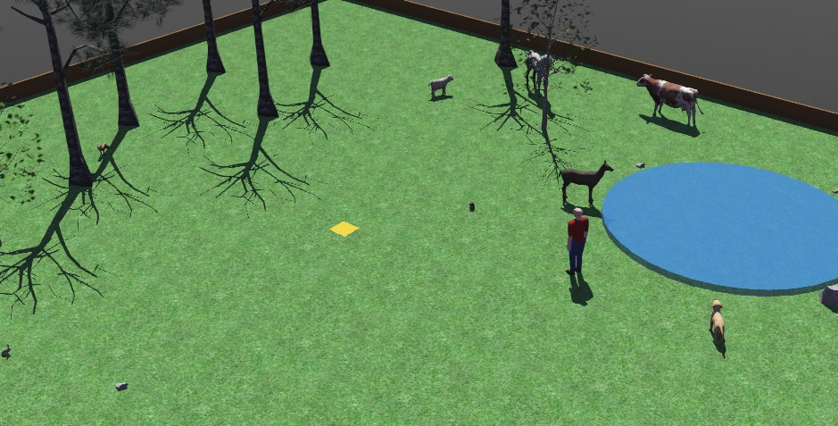

# Ranger Robot - animal patrol in Webots



A TurtleBot3 Burger patrols a simulated animal reserve with deer, horses, cows, sheep,
foxes, rabbits, dogs and cats (ROS 2 Jazzy + Webots R2025a).
It maps the reserve, drives itself with Nav2, spots animals with a camera, follows them,
raises an alarm when an intruder walks in, and goes home to charge when its battery is low.
Can be driven with a PS4 controller or by giving it spoken commands.

## Features

- **Drive modes:** manual, shared (assisted) and auto, switched on the PS4 controller,
  with rumble feedback
- **Autonomous patrol** with Nav2, including a keepout layer for low rocks the lidar can't see
- **Voice commands** (offline, Vosk) and **spoken announcements** (Piper TTS)
- **Animal detection:** YOLO-World fine-tuned on auto-labelled simulator images
- **Animal tracking:** camera + lidar put each animal on the map; the robot can go to or
  follow an animal
- **Wandering animals and an intruder** in the simulated reserve
- **Intruder alert** (voice warning, controller rumble, log) and a **"find the intruder"**
  search mode
- **Simulated battery:** returns to the dock at 20 %, charges, then resumes the patrol

## Setup

```bash
cd ~/ranger_ws
source env.sh                      # use in every terminal
colcon build --symlink-install
```

Models are not in the repo (`models/` is git-ignored). Put them in `~/ranger_ws/models/`:

- **Vosk speech model:** `vosk-model-small-en-us-0.15` from https://alphacephei.com/vosk/models
- **Piper voice:** `en_US-lessac-medium.onnx` (+ `.json`) from https://huggingface.co/rhasspy/piper-voices/tree/main/en/en_US/lessac/medium
- **Animal + person detectors (trained for this project):** download `animals_openvino_model.zip` and `person_openvino_model.zip` from the [Releases](../../releases) page and unzip them into `models/`
  - To retrain instead: `ros2 run ranger_bot vision_dataset collect` and `label`, fine-tune YOLO-World, export to OpenVINO as `models/animals_openvino_model`; person model: `ros2 run ranger_bot vision_dataset export-person`

- Without the detectors, run with `vision:=false`; everything else still works.

## Run

```bash
ros2 launch ranger_bot navigation.launch.py teleop:=ps4 rviz:=false
```

Vision starts about 45 s after the rest, so give it a minute. Useful options:
`vision:=false`, `rviz:=true`, `wildlife:=still` (animals stand still), `intruder_every:=300`.

## Controls

| PS4 controller | Action |
|---|---|
| Square / Circle / Triangle | Manual / shared / auto mode |
| Hold L1 + sticks | Drive (R1 = faster) |
| Hold L1/R1 + stick for 1 s in auto | Take over from the robot |
| D-pad up / down | Faster / slower |
| Hold Options | Push-to-talk for voice commands |

**Voice commands:** "manual", "shared", "auto", "patrol", "stop", "go to the deer",
"follow the fox", "go home", "find the intruder", "slow down", "speed up".

From a terminal: `ros2 run ranger_bot task "go to the lake"`.

## Package layout

- `src/ranger_bot/ranger_bot/` – the ROS 2 nodes (mode manager, tasks, patrol, voice,
  announcer, detector, tracker, intruder alert, battery, …)
- `src/ranger_bot/controllers/wildlife/` – Webots supervisor that moves the animals and
  the intruder
- `src/ranger_bot/launch/`, `config/`, `maps/`, `worlds/` – launch files, Nav2/EKF config,
  the reserve map and the Webots world
- `src/ranger_bot/test/` – unit tests (`python -m pytest src/ranger_bot/test`)

Developed with assistance by AI (Claude).
